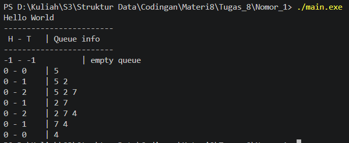
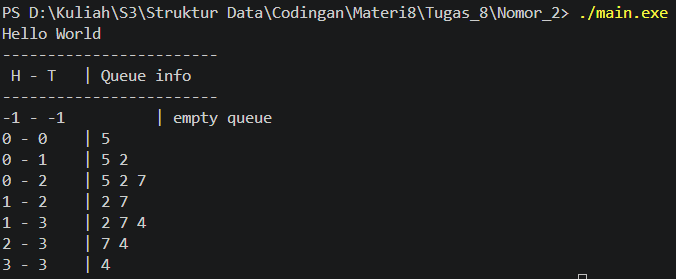
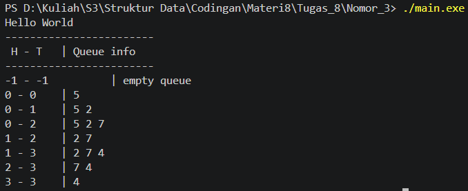

# <h1 align="center">Modul 8 QUEUE</h1>
<p align="center">Gilang Haryo Yudianto- 109082500021</p>

### A. Pengenalan Dasar Queue
Queue (antrean) merupakan struktur data linear yang cara kerjanya menyerupai barisan antrean di kehidupan sehari-hari, misalnya saat mengantre di loket tiket kereta api. Dalam struktur ini, data atau elemen yang masuk lebih awal akan diproses terlebih dahulu, sementara yang datang belakangan akan dilayani paling akhir. Mekanisme ini dikenal sebagai prinsip FIFO (*First In, First Out*). 

Pada bahasa pemrograman C/C++, *queue* dapat dibangun memakai *array* (tabel) maupun *linked list* (baik *singly* maupun *doubly linked list*). Jika menggunakan pendekatan *linked list*, alur operasinya serupa dengan *list* linear pada umumnya, tetapi aturannya lebih spesifik: pengeluaran data hanya terjadi di ujung depan (*Head*), sedangkan penambahan data baru selalu dilakukan di ujung belakang (*Tail*)—atau sebaliknya, bergantung pada kesepakatan desain yang dipakai.

### B. Komponen Penyusun Queue
Dalam penerapan *queue* berbasis *pointer* (*linked list*), tiap simpul elemen (`elmQueue`) menampung nilai data (`info`) beserta alamat menuju elemen selanjutnya (`next`). Sementara itu, struktur induk `queue` mengelola dua buah penunjuk utama:
1. Head dan Tail: `Head` berfungsi menandai posisi elemen terdepan (titik keluar/*dequeue*), sedangkan `Tail` menandai posisi elemen paling belakang (titik masuk/*enqueue*). Sebuah *queue* dianggap kosong apabila nilai `head = Nil` (di mana `Nil` merepresentasikan `NULL`).
2. Definisi Elemen & Tipe Address: Simpul *queue* dideklarasikan sebagai `struct elmQueue` yang memuat `infotype` dan `address` (*pointer* menuju `elmQueue`), lalu dirangkum ke dalam `struct queue` yang menyimpan variabel `address head, tail`.
3. Komparasi Representasi Pointer vs Tabel:
   - Representasi Tabel (*Array*): Kapasitas tampung antrean bersifat statis (terbatas sesuai ukuran tabel) dan tidak melibatkan pengelolaan memori dinamis.
   - Representasi Pointer (*Linked List*): Kapasitas antrean bersifat fleksibel atau dinamis (menyesuaikan ketersediaan memori) serta membutuhkan manajemen memori secara manual (proses alokasi dan dealokasi).

### C. Mekanisme Operasi Utama Queue
Ada dua aktivitas fundamental yang dijalankan pada struktur *queue*, yakni penambahan elemen (*Insert/Enqueue*) dan pengeluaran elemen (*Delete/Dequeue*):

#### 1. Insert / Enqueue (Penambahan di Ujung Tail)
Proses penambahan data baru selalu diarahkan ke bagian paling belakang (*Tail*):
- Sebuah simpul baru `P` dialokasikan dengan mengisi `info = X` serta mengatur `P->next = Nil`.
- Apabila antrean berisi elemen, penunjuk setelah `Q.tail` disambungkan ke `P` (`Q.tail->next = P`), lalu posisi `Q.tail` dipindahkan agar menunjuk simpul baru `P` (`Q.tail = P`). *(Catatan: Jika antrean awalnya kosong, `Q.head` dan `Q.tail` langsung diarahkan ke elemen baru tersebut).*

#### 2. Delete / Dequeue (Pengeluaran di Ujung Head)
Proses pengambilan data selalu dilakukan dari sisi paling depan (*Head*):
- Penunjuk bantu `P` diarahkan pada elemen terdepan saat ini (`P = Q.head`).
- Posisi `Q.head` digeser maju ke simpul berikutnya (`Q.head = P->next`).
- Sambungan `P->next` dilepaskan dengan mengaturnya menjadi `Nil` (`P->next = Nil`), lalu elemen `P` siap diproses atau dikembalikan nilainya.

### D. Fungsi-Fungsi Primitif Queue
Berbagai fungsi dasar (*primitif*) pada *queue* disusun ke dalam *Abstract Data Type* (ADT) dengan memisahkan bagian deklarasi pada berkas *header* (`*.h`) dan detail kode program pada berkas sumber (`*.c` atau `*.cpp`). Primitif tersebut mencakup:
1. CreateQueue & isEmpty: `CreateQueue(queue &Q)` bertugas menyiapkan antrean kosong (`head = Nil`, `tail = Nil`), sementara `isEmpty(queue Q)` mengecek apakah antrean sedang dalam keadaan kosong.
2. Alokasi & Dealokasi: `alokasi(infotype X)` menyediakan ruang memori bagi elemen baru lalu mengembalikan alamatnya (atau `Nil` bila gagal), sedangkan `dealokasi(address P)` membebaskan kembali memori elemen `P` ke sistem.
3. Pencarian Elemen: `findElm(queue Q, infotype X)` menelusuri elemen bernilai `P->info = X` dan mengembalikan alamatnya (atau `Nil` jika tidak ditemukan), sedangkan `fFindElm(queue Q, address P)` memverifikasi keberadaan alamat `P` di dalam antrean (`true`/`false`).
4. Operasi Penyisipan & Penghapusan: `insert(queue &Q, address P)` menyisipkan simpul `P` di bagian ekor *queue*, sedangkan `delete(queue &Q, address &P)` mengeluarkan simpul terdepan dan memindahkan `head` ke elemen selanjutnya.
5. Operasi Penelusuran & Pembersihan: `printInfo(queue Q)` mencetak seluruh data `info` yang ada apabila *queue* tidak kosong, `nbList(queue Q)` menghitung total elemen di dalam antrean, dan `delAll(queue &Q)` menghapus sekaligus mendealokasikan semua elemen yang tersisa.

### E. Model Implementasi Tabel dan Skenario Khusus Queue
Jika menggunakan pendekatan tabel (*array*), ada tiga variasi metode pengelolaan indeks `HEAD` dan `TAIL`:

- Alternatif 1 (Indeks HEAD Statis di 1, TAIL Dinamis):
  - Saat kosong, `HEAD = 0`; ketika terisi, `HEAD` selalu berada di indeks `1` dan `TAIL` menunjuk posisi elemen paling akhir.
  - Penambahan data dilakukan dengan menggeser `TAIL` maju (khusus saat kosong, `HEAD` diatur menjadi `1`).
  - Penghapusan data mengambil elemen pada `HEAD`, lalu menggeser maju seluruh elemen dari `HEAD+1` sampai `TAIL`, kemudian memundurkan `TAIL` (dengan penanganan khusus bila hanya tersisa satu elemen). Pendekatan ini sangat mirip dengan antrean fisik, tetapi kurang optimal karena memakan waktu untuk menggeser data.

- Alternatif 2 (Indeks HEAD dan TAIL Sama-Sama Dinamis):
  - Saat kosong, `HEAD = 0`. Proses penambahan elemen identik dengan Alternatif 1 (memajukan `TAIL`, dengan syarat khusus `HEAD = 1` jika antrean kosong).
  - Penghapusan elemen cukup dengan mengambil data pada `HEAD` lalu menggeser indeks `HEAD` maju (dengan penyesuaian khusus saat tersisa 1 elemen). Cara ini jauh lebih efisien daripada Alternatif 1 karena tidak perlu menggeser elemen setiap kali *dequeue*. Namun, metode ini rentan mengalami kondisi penuh semu saat `TAIL` menyentuh batas `IndexMax` meski di bagian depan masih terdapat ruang kosong—sehingga tetap dibutuhkan pergeseran elemen ketika `TAIL` mentok di `IndexMax`.
  - Ilustrasi Alternatif 2: Kondisi awal kosong (`Head = 0, Tail = 0`) $\rightarrow$ setelah diisi data `8, 3, 6, 9, 15, 1` (`Head = 1, Tail = 6`) $\rightarrow$ setelah dilakukan satu kali *dequeue* (`Head = 2, Tail = 6`).

- Alternatif 3 (HEAD dan TAIL Melingkar / *Circular Buffer*):
  - Penunjuk `HEAD` dan `TAIL` bergerak memutar menyusuri indeks tabel dari awal sampai batas akhir, lalu kembali berputar ke indeks `1` (antrean kosong ditandai dengan `HEAD = 0`).
  - Apabila `TAIL` menyentuh `IdxMax`, indeks berikutnya (*successor*) akan kembali ke `1`; hal serupa berlaku saat `HEAD` melewati `IdxMax`, *successor*-nya otomatis kembali ke `1`. Teknik *circular buffer* ini sangat efisien karena sepenuhnya menghilangkan kebutuhan menggeser elemen.

- Modifikasi dengan Variabel `COUNT`: Menambahkan atribut `COUNT` (pencatat jumlah elemen *queue*) agar kapasitas yang terisi dapat diketahui secara langsung tanpa perhitungan selisih indeks, meskipun proses penambahan data tetap memerlukan perhitungan posisi `TAIL`.

- Contoh Aplikasi di Dunia Nyata:
  - Sistem layanan antrean pelanggan seperti di bank, rumah sakit, atau loket pembelian tiket.
  - Manajemen penjadwalan tugas/proses (*job/task queue*) pada sistem operasi serta *buffer* aliran data yang wajib dieksekusi sesuai urutan kedatangannya.

## Guided 1

### 1. File Queue.h

```C++
/* File : queue.h
   Contoh ADT queue dengan representasi fisik pointer
   Representasi address dengan pointer
   Tipe info adalah integer */

#ifndef QUEUE_H_INCLUDE
#define QUEUE_H_INCLUDE

#include <iostream>
#define Nil NULL

typedef int infotype;
typedef struct elmQ *address;

struct elmQ {
    infotype info;
    address next;
};

/* Deklarasi tipe data queue, terdiri dari head dan tail, 
   queue kosong jika head = Nil */
struct queue {
    address head;
    address tail;
};

/* Prototype */

/********* Pengecekan apakah queue kosong ***********/
bool isEmpty(queue Q);
/* Mengembalikan nilai true jika queue kosong */

/********* Pembuatan queue kosong *********/
void CreateQueue(queue &Q);
/* I.S. sembarang
   F.S. terbentuk queue kosong */

/********* Manajemen memori *********/
address alokasi(infotype X);
/* Mengirimkan address dari alokasi elemen
   Jika alokasi berhasil, maka nilai address tidak Nil
   dan jika gagal, nilai address Nil */

void dealokasi(address P);
/* I.S. P terdefinisi
   F.S. memori yang digunakan P dikembalikan ke sistem */

/********* Pencarian sebuah elemen list *********/
address findElm(queue Q, infotype X);
/* Mencari apakah ada elemen queue dengan P->info = X
   Jika ada, mengembalikan address elemen tsb, dan Nil jika sebaliknya */

bool fFindElm(queue Q, address P);
/* Mencari apakah ada elemen queue dengan alamat P
   Mengembalikan true jika ada dan false jika tidak ada */

/********* Penambahan elemen **********/
void insert(queue &Q, address P);
/* I.S. sembarang, P sudah dialokasikan
   F.S. menempatkan elemen beralamat P pada akhir queue */

/********* Penghapusan sebuah elemen **********/
void del(queue &Q, address &P);
/* I.S. queue tidak kosong
   F.S. P menunjuk elemen pertama queue, head dari queue menunjuk pada 
        next elemen head yang lama. Queue mungkin menjadi kosong */

/********* Proses semua elemen queue **********/
void printInfo(queue Q);
/* I.S. queue mungkin tidak kosong
   F.S. jika queue tidak kosong, maka menampilkan semua info yang ada pada queue */

int nbList(queue Q);
/* Mengembalikan jumlah elemen pada queue */

void delAll(queue &Q);
/* Menghapus semua elemen pada queue dan semua elemen di-dealokasi */

#endif


```

### 2. File Queue.cpp

```C++
#include "queue.h"
using namespace std;

bool isEmpty(queue Q) {
    return (Q.head == Nil);
}

void CreateQueue(queue &Q) {
    Q.head = Nil;
    Q.tail = Nil;
}

address alokasi(infotype X) {
    address P = new (nothrow) elmQ;
    if (P != Nil) {
        P->info = X;
        P->next = Nil;
    }
    return P;
}

void dealokasi(address P) {
    delete P;
}

address findElm(queue Q, infotype X) {
    address P = Q.head;
    while (P != Nil) {
        if (P->info == X) {
            return P;
        }
        P = P->next;
    }
    return Nil;
}

bool fFindElm(queue Q, address P) {
    address R = Q.head;
    while (R != Nil) {
        if (R == P) {
            return true;
        }
        R = R->next;
    }
    return false;
}

void insert(queue &Q, address P) {
    if (P != Nil) {
        if (isEmpty(Q)) {
            Q.head = P;
            Q.tail = P;
        } else {
            (Q.tail)->next = P;
            Q.tail = P;
        }
    }
}

void del(queue &Q, address &P) {
    if (!isEmpty(Q)) {
        P = Q.head;
        if (Q.head == Q.tail) {
            Q.head = Nil;
            Q.tail = Nil;
        } else {
            Q.head = P->next;
        }
        P->next = Nil;
    } else {
        P = Nil;
    }
}

void printInfo(queue Q) {
    if (isEmpty(Q)) {
        cout << "Queue kosong" << endl;
    } else {
        address P = Q.head;
        while (P != Nil) {
            cout << P->info << " ";
            P = P->next;
        }
        cout << endl;
    }
}

int nbList(queue Q) {
    int jumlah = 0;
    address P = Q.head;
    while (P != Nil) {
        jumlah++;
        P = P->next;
    }
    return jumlah;
}

void delAll(queue &Q) {
    address P;
    while (!isEmpty(Q)) {
        del(Q, P);
        dealokasi(P);
    }
}


```

### 3. File main.cpp

```C++
#include <iostream>
#include "queue.h"
using namespace std;

int main() {
    queue Q;
    address P;

    CreateQueue(Q);
    cout << "IsEmpty : " << isEmpty(Q) << endl;
    printInfo(Q);

    insert(Q, alokasi(5));
    insert(Q, alokasi(2));
    insert(Q, alokasi(7));
    cout << "Setelah insert 5, 2, 7" << endl;
    printInfo(Q);
    cout << "nbList : " << nbList(Q) << endl;

    P = findElm(Q, 2);
    if (P != Nil) {
        cout << "findElm(2) ketemu, info = " << P->info << endl;
        cout << "fFindElm : " << fFindElm(Q, P) << endl;
    }
    if (findElm(Q, 9) == Nil) {
        cout << "findElm(9) tidak ketemu" << endl;
    }

    del(Q, P);
    cout << "Setelah delete, Elemen yang keluar = " << P->info << endl;
    dealokasi(P);
    printInfo(Q);

    delAll(Q);
    cout << "Setelah delAll" << endl;
    printInfo(Q);
    cout << "IsEmpty : " << isEmpty(Q) << endl;

    return 0;
}


```
queue.h, queue.cpp, dan main.cpp. File queue.h berfungsi mendefinisikan struktur simpul elmQ, tipe data antrean beserta penunjuk head dan tail, serta mendeklarasikan seluruh fungsi dasar seperti pembuatan antrean, alokasi memori, pencarian, penyisipan, penghapusan, hingga pencetakan elemen.

Seluruh logika teknis dari deklarasi tersebut dijabarkan di dalam queue.cpp, mencakup penanganan kondisi khusus (seperti antrean kosong atau hanya berisi satu elemen) ketika melakukan penyisipan di bagian ekor (tail), pengambilan di bagian kepala (head), maupun manajemen memori. Rangkaian operasi tersebut kemudian diuji secara terstruktur melalui program utama pada main.cpp, dimulai dari tahap inisialisasi, manipulasi dan pencarian data, hingga pengosongan seluruh elemen antrean secara menyeluruh menggunakan delAll.

## Guided 2

### 1. File Queue.h

```C++
#ifndef QUEUE_H
#define QUEUE_H

#include <iostream>
using namespace std;

const int MAKSIMAL = 5;

struct queue {
    string nama[MAKSIMAL];
    int head;
    int tail;
};

bool isFull(queue Q);
bool isEmpty(queue Q);
void CreateQueue(queue &Q);
void enQueue(queue &Q, string nama);
void deQueue(queue &Q);
void viewQueue(queue Q);

#endif

```

### 2. File Queue.cpp

```C++
#include "queue.h"
#include <iostream>

using namespace std;

// NOTE : 
// Implementasi 1 = head diam, tail bergerak (Queue Linear Statis, kerana head nya tetap diam)
// Implementasi 2 = head bergerak, tail bergerak (Queue Linear Dinamis, karena head & tail nya sama-sama bergerak)
// Implementasi 3 = head dan tail berputar (Queue Circular, karena jika udh mentok tapi masih ada space, diputar sehingga tail bisa ada didepan head)

bool isEmpty(queue Q){
    if(Q.head == -1 && Q.tail == -1){
        return true;
    } else {
        return false;
    }
}

//isFull implmenetasi 1 & 2
bool isFull(queue Q){
    if(Q.tail == MAKSIMAL - 1){
        return true;
    } else {
        return false;
    }
}

// //isFull implementasi 3
// bool isFull(queue Q){
//     if((Q.tail + 1) % MAKSIMAL == Q.head){
//         return true;
//     } else {
//         return false;
//     }
// }

void CreateQueue(queue &Q){ //terbentuk queue dengan head = -1 dan tail = -1 
    Q.head = -1;
    Q.tail = -1;
}
 

//enqueue implementasi 1 & 2
void enQueue(queue &Q, string nama){
    if(isFull(Q) == true){
        cout << "Queue sudah penuh!" << endl;
    } else {
        if(isEmpty(Q) == true){
            Q.head = Q.tail = 0;
        } else {
            Q.tail++;
        }
        Q.nama[Q.tail] = nama;
        cout << "nama " << nama << " berhasil ditambahkan kedalam queue!" << endl;
    }
}

// //enQueue implementasi 3
// void enQueue(queue &Q, string nama){
//     if(isFull(Q) == true){
//         cout << "Queue sudah penuh!" << endl;
//     } else {
//         if(isEmpty(Q) == true){
//             Q.head = Q.tail = 0;
//         } else {
//             Q.tail = (Q.tail + 1) % MAKSIMAL; // bergerak melingkar
//         }
//         Q.nama[Q.tail] = nama;
//         cout << "nama " << nama << " berhasil ditambahkan kedalam queue!" << endl;
//     }
// }

//dequeue implementasi 1
void deQueue(queue &Q){
    if(isEmpty(Q) == true){
        cout << "Queue kosong!" << endl;
    } else {
        cout << "Mengahapus data " << Q.nama[Q.head] << "..." << endl;
        for(int i = 0; i < Q.tail; i++){
            Q.nama[i] =  Q.nama[i+1];
        }
        Q.tail--;
        if(Q.tail < 0){ //kalo semua isi queue nya udh dikelaurin, set head & tail ke -1
            Q.head = -1;
            Q.tail = -1;
        }
    }
}

// //dequeue implementasi 2
// void deQueue(queue &Q){
//     if(isEmpty(Q) == true){
//         cout << "Queue kosong!" << endl;
//     } else {
//         cout << "Mengahapus data " << Q.nama[Q.head] << "..." << endl;
//         Q.head++;
//         if(Q.head > Q.tail){ //kalo elemennya udh abis (head akan lebih 1 dari tail), maka reset ulang head & tail ke -1
//             Q.head = -1;
//             Q.tail = -1;
//         }
//     }
// }

// //deQueue implementasi 3
// void deQueue(queue &Q){
//     if(isEmpty(Q) == true){
//         cout << "Queue kosong!" << endl;
//     } else {
//         cout << "Mengahapus data " << Q.nama[Q.head] << "..." << endl;
//         if(Q.head == Q.tail){ //kalo elemennya tinggal 1, langsungkan saja head & tail nya reset ke -1
//             Q.head = -1;
//             Q.tail = -1;
//         } else {
//             Q.head = (Q.head + 1) % MAKSIMAL; // bergerak melingkar
//         }
//     }
// }

//viewQueue implementasi 1 & 2
void viewQueue(queue Q){
    if(isEmpty(Q) == true){
        cout << "Queue kosong!" << endl;
    } else {
        for(int i = Q.head; i <= Q.tail; i++){
            cout << i -  Q.head + 1 << ". " << Q.nama[i] << endl;
        }
    }
    cout << endl;
}

// //viewQueue implementasi 3
// void viewQueue(queue Q){
//     if(isEmpty(Q) == true){
//         cout << "Queue kosong!" << endl;
//     } else {
//         int i = Q.head;
//         int count = 1;
//         while(true){
//             cout << count << ". " << Q.nama[i] << endl;
//             if(i == Q.tail){
//                 break;
//             }
//             i = (i + 1) % MAKSIMAL;
//             count++;
//         }   
//     }
// }
```

### 3. File main.cpp

```C++
#include "queue.h"
#include <iostream>

using namespace std;

int main(){
    queue Q;

    CreateQueue(Q);
    enQueue(Q, "Dimas");
    enQueue(Q, "Arvin");
    enQueue(Q, "Rizal");
    enQueue(Q, "Hafizh");
    enQueue(Q, "Fathur");
    enQueue(Q, "Daffa");
    cout << endl;

    cout << "--- Isi Queue Setelah enQueue ---" << endl;
    viewQueue(Q);
    cout << endl;

    deQueue(Q);
    deQueue(Q);
    deQueue(Q);
    deQueue(Q);
    // deQueue(Q);
    // deQueue(Q);
    cout << endl;

    cout << "--- Isi Queue Setelah deQueue ---" << endl;
    viewQueue(Q);

    return 0;
}

```
Implementasi Abstract Data Type (ADT) Queue berbasis array statis bertipe string dengan batas maksimal lima elemen ini disusun ke dalam tiga bagian, yakni queue.h, queue.cpp, dan main.cpp. Berkas queue.h mengatur struktur antrean lengkap dengan indeks head dan tail (bernilai awal -1 sebagai penanda kosong) serta memuat deklarasi fungsi dasar seperti CreateQueue, isEmpty, isFull, enQueue, deQueue, dan viewQueue.

Di dalam queue.cpp, logika program utama menerapkan metode indeks head tetap di posisi awal dengan menggeser elemen ke kiri setiap kali deQueue dijalankan, sekaligus menyediakan opsi alternatif berupa komentar untuk metode head-tail bergerak dan circular queue berbasis operasi modulo. Keseluruhan fungsi tersebut kemudian diuji dalam main.cpp melalui simulasi pengisian enam data nama (dengan elemen terakhir tertolak akibat kapasitas penuh), penayangan isi antrean, serta penghapusan beberapa elemen terdepan sesuai prinsip FIFO (First In, First Out) sebelum menampilkan data yang tersisa.

## Unguided 

### 1. Queue menggunakan ARRAY 


### queue.h
```C++
#ifndef QUEUE_H_INCLUDED
#define QUEUE_H_INCLUDED

#include <iostream>
using namespace std;

const int MAX_QUEUE = 5;
typedef int infotype;

struct Queue {
    infotype info[MAX_QUEUE];
    int head;
    int tail;
};

void createQueue(Queue &Q);
bool isEmptyQueue(Queue Q);
bool isFullQueue(Queue Q);
void enqueue(Queue &Q, infotype x);
infotype dequeue(Queue &Q);
void printInfo(Queue Q);

#endif
```

### queue.cpp 
```C++
#include "queue.h"

void createQueue(Queue &Q) {
    Q.head = -1;
    Q.tail = -1;
}

bool isEmptyQueue(Queue Q) {
    return (Q.head == -1 && Q.tail == -1);
}

bool isFullQueue(Queue Q) {
    return (Q.tail == MAX_QUEUE - 1);
}

void enqueue(Queue &Q, infotype x) {
    if (isFullQueue(Q)) {
        cout << "Queue penuh" << endl;
    } else {
        if (isEmptyQueue(Q)) {
            Q.head = 0;
            Q.tail = 0;
        } else {
            Q.tail++;
        }
        Q.info[Q.tail] = x;
    }
}

infotype dequeue(Queue &Q) {
    infotype x = -1;
    if (isEmptyQueue(Q)) {
        cout << "Queue kosong" << endl;
    } else {
        x = Q.info[Q.head];
        if (Q.head == Q.tail) {
            Q.head = -1;
            Q.tail = -1;
        } else {
            for (int i = Q.head; i < Q.tail; i++) {
                Q.info[i] = Q.info[i + 1];
            }
            Q.tail--;
        }
    }
    return x;
}

void printInfo(Queue Q) {
    cout << Q.head << " - " << Q.tail << " \t | ";
    if (isEmptyQueue(Q)) {
        cout << "empty queue" << endl;
    } else {
        for (int i = Q.head; i <= Q.tail; i++) {
            cout << Q.info[i];
            if (i < Q.tail) {
                cout << " ";
            }
        }
        cout << endl;
    }
}
```


### main.cpp 
```C++
#include "queue.h"

int main() {
    cout << "Hello World" << endl;
    Queue Q;
    createQueue(Q);

    cout << "------------------------" << endl;
    cout << " H - T \t | Queue info" << endl;
    cout << "------------------------" << endl;
    printInfo(Q);
    enqueue(Q, 5); printInfo(Q);
    enqueue(Q, 2); printInfo(Q);
    enqueue(Q, 7); printInfo(Q);
    dequeue(Q); printInfo(Q);
    enqueue(Q, 4); printInfo(Q);
    dequeue(Q); printInfo(Q);
    dequeue(Q); printInfo(Q);

    return 0;
}
```
### Output Unguided 1 :

##### Output 1


Implementasi kode nomor 1 (queue.h, queue.cpp, dan main.cpp) menerapkan struktur Queue berbasis array Alternatif 1 dengan posisi head tetap di indeks 0 selama antrean berisi data dan tail yang bergerak dinamis. Proses dimulai melalui fungsi createQueue yang menginisialisasi head dan tail bernilai -1 sebagai tanda antrean kosong. Ketika operasi enqueue dilakukan pertama kali, kedua indeks tersebut diubah menjadi 0 untuk menyimpan data awal pada Q.info[0], sementara penambahan elemen berikutnya cukup menggeser indeks tail maju (Q.tail++) tanpa mengubah posisi head.

Pada saat operasi dequeue dieksekusi, data terdepan di Q.head (indeks 0) diambil terlebih dahulu; jika antrean hanya menyisakan satu elemen (Q.head == Q.tail), kedua indeks dikembalikan ke -1, sedangkan jika masih terdapat elemen lain, seluruh data digeser satu posisi ke kiri dan nilai Q.tail dikurangi satu (Q.tail--). Alur kerja ini ditampilkan melalui fungsi printInfo yang mencetak status indeks head - tail beserta isinya, sebagaimana diuji pada main.cpp melalui masuknya angka 5, 2, dan 7, keluarnya angka 5 yang menyebabkan angka 2 dan 7 bergeser ke indeks 0 dan 1, hingga antrean kembali kosong (-1 - -1).


### 2. Queue pada file “queue.cpp” dengan menerapkan mekanisme queue  Alternatif 2 (head bergerak, tail bergerak). 

### queue.h
```C++
#ifndef QUEUE_H_INCLUDED
#define QUEUE_H_INCLUDED

#include <iostream>
using namespace std;

const int MAX_QUEUE = 5;
typedef int infotype;

struct Queue {
    infotype info[MAX_QUEUE];
    int head;
    int tail;
};

void createQueue(Queue &Q);
bool isEmptyQueue(Queue Q);
bool isFullQueue(Queue Q);
void enqueue(Queue &Q, infotype x);
infotype dequeue(Queue &Q);
void printInfo(Queue Q);

#endif
```

### queue.cpp 
```C++
#include "queue.h"

void createQueue(Queue &Q) {
    Q.head = -1;
    Q.tail = -1;
}

bool isEmptyQueue(Queue Q) {
    return (Q.head == -1 && Q.tail == -1);
}

bool isFullQueue(Queue Q) {
    return (Q.tail == MAX_QUEUE - 1);
}

void enqueue(Queue &Q, infotype x) {
    if (isFullQueue(Q)) {
        cout << "Queue penuh" << endl;
    } else {
        if (isEmptyQueue(Q)) {
            Q.head = 0;
            Q.tail = 0;
        } else {
            Q.tail++;
        }
        Q.info[Q.tail] = x;
    }
}

infotype dequeue(Queue &Q) {
    infotype x = -1;
    if (isEmptyQueue(Q)) {
        cout << "Queue kosong" << endl;
    } else {
        x = Q.info[Q.head];
        if (Q.head == Q.tail) {
            Q.head = -1;
            Q.tail = -1;
        } else {
            Q.head++;
        }
    }
    return x;
}

void printInfo(Queue Q) {
    cout << Q.head << " - " << Q.tail << " \t | ";
    if (isEmptyQueue(Q)) {
        cout << "empty queue" << endl;
    } else {
        for (int i = Q.head; i <= Q.tail; i++) {
            cout << Q.info[i];
            if (i < Q.tail) {
                cout << " ";
            }
        }
        cout << endl;
    }
}
```


### main.cpp 
```C++
#include "queue.h"

int main() {
    cout << "Hello World" << endl;
    Queue Q;
    createQueue(Q);

    cout << "------------------------" << endl;
    cout << " H - T \t | Queue info" << endl;
    cout << "------------------------" << endl;
    printInfo(Q);
    enqueue(Q, 5); printInfo(Q);
    enqueue(Q, 2); printInfo(Q);
    enqueue(Q, 7); printInfo(Q);
    dequeue(Q); printInfo(Q);
    enqueue(Q, 4); printInfo(Q);
    dequeue(Q); printInfo(Q);
    dequeue(Q); printInfo(Q);

    return 0;
}
```
### Output Unguided 2 :

##### Output 2


Perbedaan paling mendasar antara queue.cpp Alternatif 2 dan Alternatif 1 terdapat pada penanganan kondisi else di dalam fungsi dequeue. Jika pada Alternatif 1 sisa elemen digeser ke kiri menggunakan perulangan for diikuti pengurangan indeks Q.tail-- untuk mempertahankan posisi head di indeks 0, maka pada Alternatif 2 mekanisme pergeseran tersebut dihilangkan dan diganti langsung dengan Q.head++ agar indeks head ikut bergerak maju menunjuk elemen berikutnya.

Adapun fungsi-fungsi pendukung lainnya seperti createQueue, isEmptyQueue, isFullQueue, enqueue, dan printInfo tetap mempertahankan logika yang sama seperti Alternatif 1 agar kompatibel dengan skenario pengujian pada main.cpp. Perubahan ini berdampak langsung pada perubahan posisi H - T: setelah angka 5, 2, dan 7 masuk (0 - 2), pemanggilan dequeue pertama mengubah indeks menjadi 1 - 2, dilanjutkan 1 - 3 saat angka 4 masuk, lalu bergeser berturut-turut menjadi 2 - 3 dan 3 - 3 pada dua kali dequeue berikutnya hingga kembali ke -1 - -1 ketika seluruh elemen habis.

### 3.  Stack dengan Input Stream

### queue.h
```C++
#ifndef QUEUE_H_INCLUDED
#define QUEUE_H_INCLUDED

#include <iostream>
using namespace std;

const int MAX_QUEUE = 5;
typedef int infotype;

struct Queue {
    infotype info[MAX_QUEUE];
    int head;
    int tail;
};

void createQueue(Queue &Q);
bool isEmptyQueue(Queue Q);
bool isFullQueue(Queue Q);
void enqueue(Queue &Q, infotype x);
infotype dequeue(Queue &Q);
void printInfo(Queue Q);

#endif
```

### queue.cpp 
```C++
#include "queue.h"

void createQueue(Queue &Q) {
    Q.head = -1;
    Q.tail = -1;
}

bool isEmptyQueue(Queue Q) {
    return (Q.head == -1 && Q.tail == -1);
}

bool isFullQueue(Queue Q) {
    return ((Q.tail + 1) % MAX_QUEUE == Q.head);
}

void enqueue(Queue &Q, infotype x) {
    if (isFullQueue(Q)) {
        cout << "Queue penuh" << endl;
    } else {
        if (isEmptyQueue(Q)) {
            Q.head = 0;
            Q.tail = 0;
        } else {
            Q.tail = (Q.tail + 1) % MAX_QUEUE;
        }
        Q.info[Q.tail] = x;
    }
}

infotype dequeue(Queue &Q) {
    infotype x = -1;
    if (isEmptyQueue(Q)) {
        cout << "Queue kosong" << endl;
    } else {
        x = Q.info[Q.head];
        if (Q.head == Q.tail) {
            Q.head = -1;
            Q.tail = -1;
        } else {
            Q.head = (Q.head + 1) % MAX_QUEUE;
        }
    }
    return x;
}

void printInfo(Queue Q) {
    cout << Q.head << " - " << Q.tail << " \t | ";
    if (isEmptyQueue(Q)) {
        cout << "empty queue" << endl;
    } else {
        int i = Q.head;
        while (true) {
            cout << Q.info[i];
            if (i == Q.tail) {
                break;
            }
            cout << " ";
            i = (i + 1) % MAX_QUEUE;
        }
        cout << endl;
    }
}
```


### main.cpp 
```C++
#include "queue.h"

int main() {
    cout << "Hello World" << endl;
    Queue Q;
    createQueue(Q);

    cout << "------------------------" << endl;
    cout << " H - T \t | Queue info" << endl;
    cout << "------------------------" << endl;
    printInfo(Q);
    enqueue(Q, 5); printInfo(Q);
    enqueue(Q, 2); printInfo(Q);
    enqueue(Q, 7); printInfo(Q);
    dequeue(Q); printInfo(Q);
    enqueue(Q, 4); printInfo(Q);
    dequeue(Q); printInfo(Q);
    dequeue(Q); printInfo(Q);

    return 0;
}
```

### Output Unguided 3 :

##### Output 3


Perbedaan utama pada queue.cpp Alternatif 3 (circular buffer) dibandingkan Alternatif 2 terletak pada mekanisme pergerakan indeks head dan tail, deteksi kondisi penuh, serta pola pencetakan data agar indeks dapat berputar kembali ke awal array. Pada fungsi isFullQueue, pengecekan diubah menggunakan rumus modulo ((Q.tail + 1) % MAX_QUEUE == Q.head) untuk memastikan posisi berikutnya tidak menabrak head. Selain itu, operasi penambahan indeks pada enqueue dan dequeue diubah menjadi (Q.tail + 1) % MAX_QUEUE dan (Q.head + 1) % MAX_QUEUE, sehingga indeks otomatis kembali ke posisi 0 setelah melewati batas akhir tanpa memerlukan pergeseran elemen ataupun memicu kondisi penuh semu.

Penyesuaian serupa juga diterapkan pada fungsi printInfo dengan mengganti perulangan linear biasa menjadi perulangan melingkar berbasis i = (i + 1) % MAX_QUEUE hingga mencapai indeks Q.tail. Perubahan logika pencetakan ini mutlak diperlukan karena dalam skema melingkar, posisi Q.tail dapat berada di indeks yang lebih kecil dari Q.head setelah berputar melewati ujung array, sehingga iterasi linear standar tidak mampu menampilkan seluruh isi antrean secara akurat., First-Out (LIFO), yang selanjutnya dapat dikembalikan ke urutan semula dengan memanggil prosedur balikStack.

## Kesimpulan
Modul ini mengupas tuntas implementasi struktur data Queue (antrean) yang beroperasi berdasarkan prinsip FIFO (First In, First Out), yakni data yang pertama kali masuk akan diproses atau keluar terlebih dahulu. Dalam materi dan sesi praktikum ini, konsep antrean dipelajari melalui dua metode utama: representasi pointer (menggunakan linked list dengan penunjuk Head dan Tail) serta representasi tabel (menggunakan array statis berkapasitas tetap yang mencakup varian Alternatif 1, Alternatif 2, hingga circular buffer pada Alternatif 3).

Selain mendalami kedua pendekatan tersebut, modul ini juga melatih perancangan kode program secara modular dengan memisahkan file header dan file implementasi. Peserta praktikum juga dibimbing untuk menguasai fungsi-fungsi dasar dalam mengelola antrean, meliputi tahap pembuatan antrean (createQueue), pengecekan kapasitas kosong atau penuh (isEmptyQueue, isFullQueue), penambahan elemen (enqueue), penghapusan elemen (dequeue), hingga menampilkan seluruh isi antrean (printInfo).
## Referensi
[1] Deitel, P., & Deitel, H. (2017). C++ How to Program (10th ed.). Boston: Pearson.<br>
[2] Liem, I. (2003). Diktat Pemrograman Prosedural. Bandung: Departemen Teknik Informatika Institut Teknologi Bandung.<br>
[3] Laboratorium Informatika Fakultas Informatika Telkom University. (n.d.). Modul 4: Singly Linked List (Bagian Pertama), Modul Praktikum Struktur Data.<br>
[4] cppreference.com. (n.d.). new expression dan delete expression. https://en.cppreference.com/w/cpp/language/new<br>

